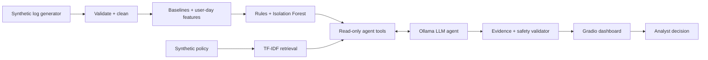

# Insider Threat Login and Access Anomaly Agent

**Group 8B** · AI/ML in Cybersecurity Capstone · Laurentian University · Fall 2026

| Role | Name |
|---|---|
| Supervisor | Farhad Abbasi Amiri |
| Author | Yash Baksheshkumar Patel |
| Author | Yash Niravkumar Patel |
| Author | Jay Barot |
| Author | Smit Panchal |
| Author | Devendra Suther |

A small UEBA (User and Entity Behavior Analytics) investigation assistant for SOC analysts. It reads
**synthetic** login/access logs for 100 accounts, learns each account's normal behaviour, scores unusual
user-days with transparent rules (plus an Isolation Forest comparison), and builds timelines. A local
**Ollama** LLM agent calls read-only tools to gather evidence and policy passages and writes grounded analyst
notes. A Gradio dashboard puts it all in front of a human, who makes every decision.

> **An anomaly is not proof of wrongdoing.** This prototype prioritizes and explains activity for review. It
> never disables accounts, changes permissions or labels people.

📄 **Full project report:** [docs/REPORT.md](docs/REPORT.md)

## Highlights

| | |
|---|---|
| Data | 100 synthetic accounts, 28 days, ~12,600 events, 7 injected scenarios (incl. one benign, one deliberately hard) |
| Detection | 6 explainable rules (0–100 review priority, every point linked to event IDs) + Isolation Forest comparison |
| RAG | TF-IDF retrieval over a synthetic access-review policy, with section citations |
| Agent | Ollama `qwen2.5-coder:7b`, 4 read-only allowlisted tools, structured JSON, evidence/safety validator |
| UI | Gradio: department/user/risk filters, evidence, timeline, agent notes, tool trace, human review |
| Results | Rules: precision 0.82 / recall 0.88 on a held-out seed · Agent: 10/10 prepared cases passed |

## Quick start (Windows PowerShell)

```powershell
python -m venv .venv
.\.venv\Scripts\pip install -r requirements.txt
.\.venv\Scripts\python -m pytest -q              # 27 tests, no LLM needed
.\.venv\Scripts\python app.py                    # http://127.0.0.1:7860
```

The synthetic data is already in `data/synthetic/`. Regenerate it with `python -m src.generate_data`.

For the AI agent, install [Ollama](https://ollama.com) and pull a tool-capable model:

```powershell
ollama pull qwen2.5-coder:7b       # default; override with $env:OLLAMA_MODEL = "qwen2.5:7b"
```

Without Ollama the dashboard still works. The agent button reports that the LLM is unavailable, and
**Offline summary (no LLM)** gives a deterministic, clearly labelled template.

## Demo script (≈3 minutes)

1. Risk filter **Flagged (medium + high)**. Point out the scores are review priorities.
2. Click the **U010 / 2026-10-29** row. Walk through the rule table with event IDs, the baseline, and the timeline (02:05 failures → 02:08 success → `ADMIN-SERVER-9` → privileged action).
3. Click **Investigate with AI agent**. Open *Agent tool calls* to show the real tool calls, then the ✅ validation, the policy citations, the unknowns and the analyst questions.
4. Select a **SCN-06** day such as **U019 / 2026-10-27**: rules flag it, but the agent finds approved change record `CHG-0002`. This is a false positive that context resolves.
5. Record a decision in **Human review checkpoint** and show that it changes nothing but the review log.

## Architecture



Details: [docs/architecture.md](docs/architecture.md).

## Evaluation

```powershell
.\.venv\Scripts\python -m src.evaluate --holdout-seed 99   # docs/evaluation_results.md
.\.venv\Scripts\python -m src.run_agent_cases              # docs/agent_evaluation.md (needs Ollama)
```

See [docs/evaluation.md](docs/evaluation.md) for method, results and error analysis.

## Repository map

```text
app.py                      Gradio dashboard
src/config.py               All thresholds/weights and Ollama settings
src/generate_data.py        Synthetic accounts, routine activity, injected scenarios
src/ingest.py               Schema validation and cleaning
src/features.py             Baselines (pre-split) and user-day features with evidence IDs
src/scoring.py              Explainable rule score
src/detector.py             Pipeline + Isolation Forest comparison
src/timeline.py             Account timelines
src/policy_retrieval.py     RAG over policies/SYNTHETIC_POLICY.md
src/agent.py                Ollama tool-calling agent, validator, offline fallback
src/evaluate.py             Detector metrics (dev + held-out seed)
src/run_agent_cases.py      Real-LLM end-to-end cases
tests/                      pytest suite + scenarios.md
docs/                       report, architecture, data card, evaluation, ethics, presentation notes
CLAUDE.md                   Instructions given to the Claude Code coding agent
```

## Team roles (from the project brief)

| Role | Owns |
|---|---|
| Data Lead | `generate_data.py`, `ingest.py`, data card |
| AI Lead | `features.py`, `scoring.py`, `detector.py`, `evaluate.py` |
| Agent Lead | `agent.py`, `policy_retrieval.py`, policy file |
| App Lead | `app.py`, screenshots, run steps |
| Evaluation Lead | tests, `run_agent_cases.py`, evaluation + ethics docs |

## AI coding assistant

This MVP was built with **Claude Code**. The standing instructions given to the coding agent are in
[CLAUDE.md](CLAUDE.md), as the course requires. All generated code was run, tested and reviewed by the team.

## Assumptions

Synthetic data rather than LANL, because LANL has no department or location fields. Local Ollama rather than
a cloud LLM. A fictional policy, because the brief does not supply one. Rule weights are illustrative teaching
values. All of these are documented in `docs/`.
