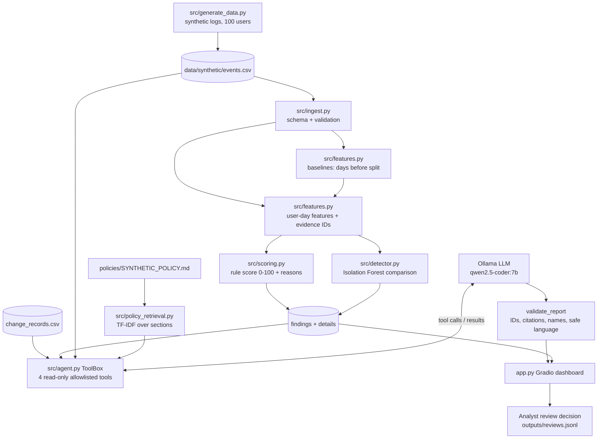

# Architecture

## Components

| Module | Responsibility |
|---|---|
| `src/generate_data.py` | Deterministic synthetic accounts, routine activity, injected scenarios, change records |
| `src/ingest.py` | Required columns, allowed values, duplicate/empty IDs, ISO timestamps, missing → `unknown` |
| `src/features.py` | Per-user baseline from days **before** `SPLIT_DATE`; one feature row per user-day with supporting event IDs |
| `src/scoring.py` | Transparent rule score (weights below); `insufficient_baseline` for accounts with < 5 baseline days |
| `src/detector.py` | Runs the pipeline; adds unsupervised Isolation Forest scores as a comparison method |
| `src/timeline.py` | Time-ordered events for one account-day, flagging events that support a rule |
| `src/policy_retrieval.py` | Section-level TF-IDF retrieval with citations; drops prompt-injection-like passages |
| `src/agent.py` | Ollama tool-calling loop, allowlisted tools, structured JSON output, validator, run log, offline fallback |
| `app.py` | Gradio UI: filters, findings, evidence, timeline, agent notes, tool trace, human review |
| `src/evaluate.py` | Precision/recall/F1 per method, per-scenario detection, false positives, held-out seed |
| `src/run_agent_cases.py` | Real-LLM end-to-end run over 10 prepared cases |

## Rule score (illustrative weights, capped at 100)

| Rule | Points | Fires when |
|---|---:|---|
| `off_hours_login` | 20 | A successful login hour is not within ±1 h of any baseline login hour |
| `new_system` | 25 | Access to a system not seen in the baseline |
| `failed_login_burst` | 20 | ≥ 5 failures, or ≥ 3 failures with z ≥ 3 vs the user's own baseline (σ floor 0.5) |
| `failures_then_success` | 20 | A success within 30 min of ≥ 3 failures |
| `unusual_privileged_action` | 20 | Privileged action by an account with no privileged baseline days |
| `new_location` | 15 | Location label not seen in the baseline (`unknown` is never counted) |

Labels: `high` ≥ 70, `medium` ≥ 40, `low` < 40. Flagged = medium or high. Thresholds were chosen in advance as
teaching values. The `failures_then_success` rule was added once during development, after SCN-02 was missed. That
is why we also report a held-out seed. Novelty rules (`off_hours`, `new_system`, `new_location`) are switched off
for accounts with insufficient history.

## Agent tools (read-only allowlist)

| Tool | Returns |
|---|---|
| `get_anomaly_evidence(user_id, date)` | Score, rules with event IDs, features, baseline summary, IF result |
| `get_user_timeline(user_id, date)` | Up to 60 time-ordered events with `flagged` marker |
| `get_change_records(user_id, date)` | Approved synthetic change windows |
| `search_access_policy(query)` | Top-3 policy passages with `SYNTHETIC_POLICY.md#SP-x.y` citations |

Guardrails: input validation (`U\d{3}`, real user, ISO date), unknown tools rejected, tool output passed as data,
risk score and label overwritten from the detector, `requires_human_review=True`, and `approved_action_taken=False`
forced. A report fails validation if it cites event IDs, citations, change IDs or system names that no tool
returned, or if it uses accusatory or enforcement language. On failure the agent gets one repair attempt, and the
UI then shows a clear ❌. Every run is logged as metadata only to `outputs/agent_runs.jsonl`.
